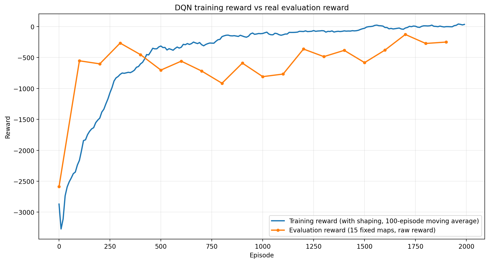
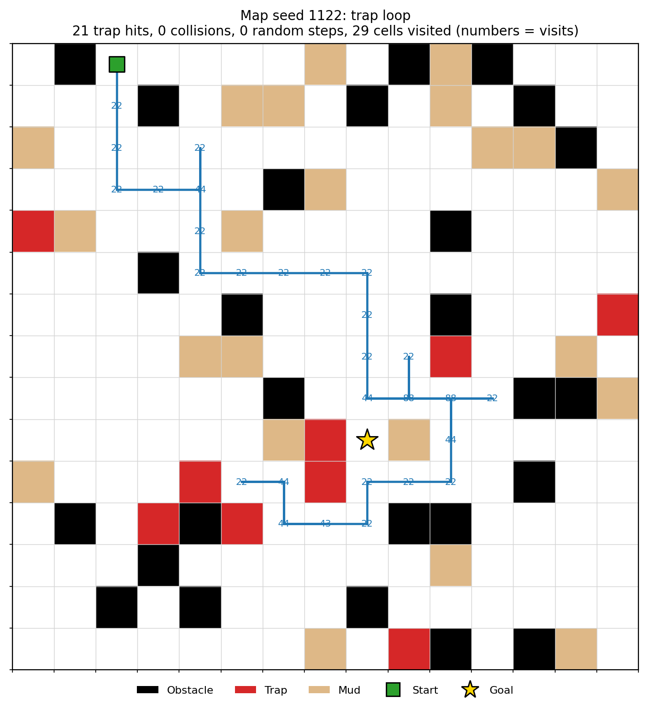
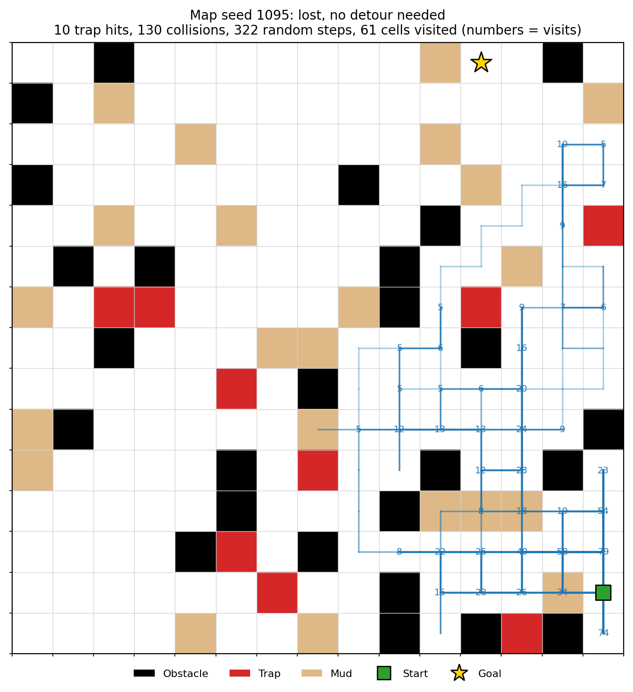

# Reinforcement Learning Exploration Agent

A grid-world reinforcement learning project built from scratch. A tabular Q-learning agent is first studied on a fixed map as navigation becomes progressively more costly, then a DQN agent is trained to solve maps it has never seen.

In the Q-learning experiments the task is to reach a fixed goal on a 15 × 15 map. The simple environment contains obstacles only, while the advanced version adds mud cells and traps. Both environments use the same seed and base obstacle layout, which makes the comparison easier to interpret.


Share of 200 unseen maps solved by a DQN according to the number of maps it trains on (blue, mean ± standard deviation over 3 seeds). A Q-learning agent trained on one map solves 6% of them. The grey curve is the score on the 15 frozen maps used to pick the checkpoint, which is too optimistic (see Generalization).

## Environment

The agent can move up, down, left or right. An episode ends when the goal is reached or after 900 steps.

| Event | Reward |
| --- | ---: |
| Regular move | -1 |
| Mud cell | -4 |
| Collision | -6 |
| Trap | -25 |
| Goal | +100 |

A trap sends the agent back to its starting position. Mud remains traversable, but makes a route more expensive.

The advanced map uses:

```text
obstacle density = 0.12
trap density     = 0.04
mud density      = 0.10
```


## Q-learning

The state is the agent's position in the grid. The Q-table stores one value for each state-action pair.

Actions are selected with an epsilon-greedy policy, with random tie-breaking when several actions share the highest Q-value.

After each transition, the table is updated with:

$$
Q(s,a) \leftarrow Q(s,a) + \alpha \left[r + \gamma \max_{a'}Q(s',a') - Q(s,a)\right]
$$

For terminal transitions, only the immediate reward is used.

The default training configuration is:

```text
episodes = 5000
alpha    = 0.10
gamma    = 0.95
epsilon  = 1.00
seed     = 4
```

Epsilon decreases during training. The curves below use a 100-episode moving average.

## Results

### Simple and advanced environments

The advanced environment is much less forgiving at the beginning of training. Random exploration leads to more collisions, longer episodes and repeated returns to the starting position after traps.


| Metric | Simple | Advanced |
| --- | ---: | ---: |
| Mean reward, first 100 episodes | -620.0 | -2328.7 |
| Mean steps, first 100 episodes | 394.1 | 788.5 |
| Mean reward, last 100 episodes | 81.7 | 80.3 |
| Greedy evaluation reward | 83 | 83 |
| Greedy evaluation steps | 18 | 18 |

Despite the large gap during exploration, both agents eventually learn a policy that reaches the goal in 18 steps, without a collision or trap during evaluation.

On this map, the hazards mainly affect the learning process rather than the final route.


### Learning rate

The learning rate was tested with values 0.05, 0.10, 0.30 and 0.50 while keeping gamma fixed at 0.95, repeated on 4 fixed maps (mean ± standard deviation across maps).


All four values converge to essentially the same final reward on every map (77 to 79, within about 3 points of each other). Alpha = 0.10 is kept as a neutral baseline rather than presented as an optimal value.

### Discount factor

The discount factor was tested with values 0.80, 0.90, 0.95 and 0.99 while keeping alpha fixed at 0.10, on the same 4 maps.


Same pattern: all four values converge to essentially the same result, so gamma = 0.95 remains the default setting. Repeating the sweep across 4 different maps confirms this insensitivity is not an artifact of a single fixed layout.

## Deep Q-Network

The Q-table above only works because the map stays fixed for all 5000 episodes. It has no way to generalize to a map it has never seen (see Generalization). The DQN agent is trained on many maps instead, to test whether a learned policy can generalize across layouts rather than to beat the tabular agent on its fixed map.

### State representation

The agent receives a local 5×5 window around its position instead of its exact coordinates, one-hot encoded over 4 channels: out-of-bounds, obstacle, trap, mud. A free cell activates none of them, since it is fully determined by the other four. A compass vector is added on top, the normalized displacement to the goal, so the agent still knows which direction to move once the goal leaves the window.

The last 4 observations are stacked into a single input. Without it the policy has no memory of where it has just been, which turned out to matter (see Problems below).

### Reward shaping

A new map every episode means the agent rarely reaches the goal through exploration alone, and there is no fixed layout to memorize a route through. A potential-based shaping term is added to the reward so that moving toward the goal is rewarded at every step:

$$
\Phi(s) = -\,d_{\text{Manhattan}}(\text{agent}, \text{goal}), \qquad
F(s,a,s') = \gamma\,\Phi(s') - \Phi(s)
$$

$\Phi$ is forced to 0 on every terminal state (goal reached or timeout), which the policy-invariance proof (Ng, Harada & Russell, 1999) requires.

An earlier version added a second term penalizing revisited positions during training, meant to discourage the cycling described below. Removed after testing: on its own it solved fewer held-out maps than no penalty at all (see Results).

### Training pool

Generating a brand new map every episode meant no map was ever seen twice, and the only trace of anything the agent learned on one lived in the replay buffer until it got evicted. Training now draws each episode's map, with replacement, from a pool of 50 maps generated once at the start of the run. The evaluation maps are generated separately and never enter the pool.

### Anti-cycle guardrail

A greedy policy with no memory of past states is a deterministic function of the map and position: if it ever returns to a state without reaching the goal, it repeats the same action forever (see Problems). Evaluation now tracks the last `2 * size` positions visited. As long as the agent keeps reaching new positions it takes its best action as usual; once it revisits one, it takes the next-best action instead, then the one after that, and falls back to a random action if it has tried every action this way and still not escaped. This only changes how the trained network is used at evaluation time, not how it is trained.

### Training configuration

```text
episodes           = 2000
gamma              = 0.99
learning rate      = 1e-4 (Adam)
batch size         = 64
epsilon            = 1.00 -> 0.05 (x0.999 per episode, floor not reached within 2000 episodes)
replay capacity    = 50000
target update freq = 1000 steps
frame stack size   = 4
observation window = 5 x 5
training pool      = 50 fixed maps, sampled with replacement
```

The target is computed with Double DQN: the online network picks the action, the target network values it, which limits the overestimation bias of a plain `max`.

### Evaluation

The training reward includes the shaping term and a map drawn from the training pool, so it says little about how good the policy actually is. Every 100 episodes, the greedy policy plus the anti-cycle guardrail is evaluated instead on 15 fixed seeds, never used for training, with the raw environment reward. The evaluation maps are generated without disturbing the training run's random state.



The two curves do not follow each other. The training reward climbs to about 0 and stays there, while the evaluation reward stays between -900 and -130 from episode 100 on and moves a lot from one checkpoint to the next. The best evaluation is around episode 1700, not at the end. This is why the checkpoint kept is the one with the best evaluation reward and not the last one.

### Results

The single-frame agent's evaluation got stuck at 900/900, a full timeout on every held-out map, in 23 of its 25 checkpoints. Adding the 4-frame stack raised its best checkpoint to 4 out of 5 fixed maps solved, in 22-32 steps, though which map failed changed from run to run.

With the training pool and 15 evaluation maps instead of 5, before the guardrail existed, the best checkpoint solved 10 of the 15. Adding the guardrail to that same checkpoint raised it to 14 of 15.

Once the guardrail existed, it became possible to check whether the revisit penalty was still worth its complexity. Four 2000-episode runs, all evaluated with the guardrail:

| Frame stack | Revisit penalty | Solved | Mean reward / steps |
| --- | --- | ---: | ---: |
| yes | yes | 14 / 15 | -145.9 / 132.5 |
| yes | no | 15 / 15 | -127.7 / 129.2 |
| no | yes | 11 / 15 | -690.7 / 392.6 |
| no | no | 12 / 15 | -554.0 / 346.9 |

The frame stack accounts for essentially all of the improvement. The revisit penalty on its own scores worse than no penalty at all. It was removed.

These scores are measured on the 15 frozen maps. The score on maps that were never used is lower (see Generalization).

## Generalization

The question behind the DQN is whether a policy trained on some maps can solve maps it has never seen. Two sets of evaluation maps are used. The 15 frozen maps (seeds 101 to 115) are evaluated every 100 episodes during training, and the checkpoint with the best score on them is the one kept. Their score is therefore optimistic. The 200 unseen maps (seeds 1001 to 1200) are not used for anything else, so their score is the one to trust. Every evaluation uses the greedy policy, the anti-cycle guardrail and the raw reward. A map counts as solved when the goal is reached before the 900-step limit.

### Q-learning against DQN

The Q-table trained on the fixed map (seed 4) is evaluated on the same maps as the DQN, with the same guardrail.

| | Q-learning | DQN |
| --- | ---: | ---: |
| Solved, 15 frozen maps | 1 / 15 | 15 / 15 |
| Mean reward, 15 frozen maps | -2224.3 | -127.7 |
| Mean steps, 15 frozen maps | 856.1 | 129.2 |
| Solved, 200 unseen maps | 12 / 200 (6.0%) | 176 / 200 (88.0%) |
| Mean reward, 200 unseen maps | -2374.4 | -407.2 |
| Mean steps, 200 unseen maps | 868.6 | 244.1 |

The DQN in this table is the run kept in `results/dqn/dqn_checkpoints/`. The same configuration (50 maps, 4 frames, 5×5 window) was trained 9 times in the experiments below, and none of those runs does as well on unseen maps. They solve 77.7% ± 3.5 of them, from 71.5% to 82.5%, with a mean reward of -627 ± 85. On the 15 frozen maps they solve 94.1% ± 6.6. The figure to quote for the DQN is therefore about 78%, and the 88% is the lucky end of the range.

Q-learning does not fail because it meets positions it has never seen. 13.9% of its steps on the frozen maps (14.1% on the unseen ones) are spent on positions missing from the Q-table, so most of the time it is on a position it knows. The values it stores for these positions are only valid on the map it was trained on, and on another map they no longer lead to the goal. It reaches the 900-step limit on 94% of the unseen maps.

### Training pool size

The DQN was trained on pools of 1, 5, 10, 25 and 50 maps, 3 seeds each, with the rest of the configuration unchanged. Mean ± standard deviation over the 3 seeds, in percentage of maps solved:

| Pool size | 15 frozen maps | 200 unseen maps |
| --- | ---: | ---: |
| 1 | 62.2 ± 20.6 | 49.8 ± 16.0 |
| 5 | 77.8 ± 8.3 | 64.2 ± 8.6 |
| 10 | 88.9 ± 8.3 | 71.7 ± 2.3 |
| 25 | 91.1 ± 3.1 | 77.5 ± 3.3 |
| 50 | 95.6 ± 3.1 | 75.5 ± 4.0 |


Training on a single map already solves about half of the unseen maps, far above Q-learning, because the observation is local and relative to the goal. Each map added to the pool helps up to about 25. Between 25 and 50 maps the difference is smaller than the spread between seeds. The spread itself shrinks from 16 points with one map to 2 to 4 points from 10 maps on.

The grey curve keeps rising up to 50 maps while the blue one flattens. The gap between the two, 12 to 20 points, comes from choosing the checkpoint on the frozen maps.

## Ablations

Each setting below was trained 3 times (seeds 4, 104 and 204) with the rest of the configuration unchanged: 50 maps in the pool, 4 stacked frames and a 5×5 window unless it is the parameter being varied. The comparison of the frame stack and the revisit penalty is in the DQN Results section above and was not repeated.


### Observation window

| Window | 15 frozen maps | 200 unseen maps |
| --- | ---: | ---: |
| 3×3 | 95.6 ± 3.1 | 86.5 ± 2.9 |
| 5×5 | 93.3 ± 5.4 | 79.2 ± 2.9 |
| 7×7 | 88.9 ± 8.3 | 73.8 ± 1.9 |

A smaller window is better. On unseen maps the 3×3 window beats the 5×5 one by 7 points and the 7×7 one by 13, which is more than the spread between seeds (2 to 3 points). The 5×5 window was chosen at the start of the project and never tuned. A possible reason is that the compass already gives the direction of the goal, and a larger window only adds inputs the network has to learn to ignore. This was only tested with 4 frames and a pool of 50 maps.

### Stacked frames

| Frames | 15 frozen maps | 200 unseen maps |
| --- | ---: | ---: |
| 1 | 84.4 ± 3.1 | 65.7 ± 5.9 |
| 2 | 91.1 ± 3.1 | 74.5 ± 7.3 |
| 4 | 93.3 ± 9.4 | 78.3 ± 2.1 |

More frames help, by 12.6 points from 1 to 4. From 2 to 4 frames the gain is 3.8 points, within the spread between seeds. A single frame still solves about two thirds of the unseen maps, so the stack improves the agent but is not what makes it generalize. 8 frames were not tested.

## Failure analysis

The checkpoint kept in `results/dqn/dqn_checkpoints/` fails on 24 of the 200 unseen maps. All 24 are timeouts at 900 steps. Compared with the 176 maps it solves, the failed maps involve far more guardrail steps (280 against 45 on average), collisions (94 against 15) and trap hits (17 against 2).

The failures fall into three groups, sorted with two thresholds (15 trap hits, 150 random steps):

| Group | Maps | What happens |
| --- | ---: | --- |
| Trap loop | 6 | The agent follows the same route again and again and enters a trap, most of the time at the same place. |
| Lost, detour needed | 9 | The shortest path first moves away from the goal. On map 1172 the agent wanders over a large part of the grid without finding the way. |
| Lost, no detour needed | 9 | The shortest path is as short as the Manhattan distance, yet the agent does not find it and takes many random steps. On map 1095 it stays around its start. |

Maps that need a detour fail more often: 11 of 41 (27%) against 13 of 159 (8%) for the others. Most failures still happen on maps without a detour, so the layout is not the whole explanation.






The network itself never chooses to enter a trap. Among the 400 trap entries on the failed maps, none comes from its best or second-best action. 282 come from its fourth choice, 19 from its third and 99 from the random fallback. On map 1122 the network gives the trap move a value of -92 against about -67 for the other three moves. The guardrail goes through the actions from best to worst while the agent keeps revisiting positions, so an agent that gets stuck next to a trap is eventually sent into it, and the trap sends it back to the start where the same route begins again.

The guardrail only remembers the last 30 positions, which looked like a cause of the loops. Giving it a memory of 60, 100 or 200 positions did not help: the agent solves fewer unseen maps (171, 170 and 164 instead of 176) and only one of the six trap loops is fixed, with the longest memory.

## Problems

The training reward looked like it was improving steadily, but that was mostly an artifact. The shaping term rewards getting closer to the goal even when the goal is never reached, and each episode's map has its own difficulty. Evaluating on fixed seeds showed that the agent was failing on held-out maps for most of the training, so the evaluation with the raw reward became the reference.

With a new map every episode, no map was ever seen twice and the training was unstable. The maps are now drawn from a pool of 50 fixed maps, so that the agent sees each of them many times.

The potential of the shaping was first set to 0 only when the goal was reached, and not on a timeout. This breaks the policy-invariance guarantee, since the potential has to be 0 on every terminal state. It is now forced to 0 in both cases.

Traced on a held-out map, both an untrained network and a fully trained one, from before the frame stack existed, oscillated between two adjacent cells for the full 900 steps. A greedy policy with no memory that revisits a state without reaching the goal repeats the same action forever. The frame stack reduced this a lot on its own. The revisit penalty was added to try to reduce it further, and the anti-cycle guardrail was added to eliminate it at evaluation time.

Once the guardrail could rescue a stuck run whatever training produced, the frame stack and the revisit penalty could be isolated instead of only tested together. The revisit penalty turned out to be harmful on its own, not just unnecessary (see Results). Its reward depends on recent position history rather than only on the current state, so it never had the policy-invariance guarantee that the rest of the shaping has, and in practice it made the training reward noisier without a payoff.

A shaping potential based on the real shortest path (BFS) would have helped the agent out of some dead ends. It was rejected because it gives the agent knowledge of the whole map, which the experiment is meant to avoid. The compass only gives the direction and distance to the goal.

Checked whether the maps that failed were simply harder: for each of the 15 frozen maps, the real shortest path (BFS, accounting for walls) is exactly the Manhattan distance, so none of them ever required moving away from the goal. The specific map that failed also changed from run to run on the same fixed evaluation set. Both pointed to training variance rather than map difficulty. The larger set of unseen maps shows that detours do make failures more likely, even if they are not the main cause (see Failure analysis).

The last checkpoint is rarely the best one, so the checkpoint with the best evaluation reward is kept. Choosing it on the 15 frozen maps made their score optimistic. The kept checkpoint solves 15 of 15 of them but 88% of the 200 unseen maps, and the average run solves about 78%. Every comparison in this README now also reports the unseen maps, and the frozen maps are only used to choose the checkpoint.

The seed fixes the maps but not the initialization of the network, because no seed is set for PyTorch. Two runs with the same seed and the same configuration therefore differ: the nine runs of the reference configuration go from 71.5% to 82.5% of unseen maps. All comparisons use 3 seeds and report the mean and the standard deviation. Fixing the PyTorch seed would make single runs reproducible and is left for later.

The first measure of unseen states in the Q-learning evaluation gave 0.2%. The evaluation added the unknown states to the Q-table as it went, so each one was only counted on its first visit. Counting every step against the states known before the evaluation gives 13.9%.

The training was slower than expected. A profile showed the Adam update running in its slow single-tensor path, fixed with `foreach=True`, and the replay buffer was built on a `deque`, whose random access is slow. It is now a list with a circular index.

The guardrail that makes the evaluation possible also sends stuck agents into traps (see Failure analysis). It is used in every experiment, so changing it means running them again. It was left as it is.

## Conclusion

A tabular agent trained on one map solves 6% of 200 unseen maps. A DQN with a local observation relative to the goal solves 77.7% ± 3.5 of the same maps on average over nine runs, and 88% for the best one. On the 15 frozen maps the figures are 1 out of 15 for Q-learning and 15 out of 15 for the kept DQN. The tabular agent is not missing positions, it stores values that belong to a single map. The DQN learns a rule that depends on what is around it and where the goal is, and that rule works on other maps.

How well it generalizes depends on its training. One training map gives 49.8% of the unseen maps, 25 maps give 77.5%, and more maps than that did not help. A 3×3 window (86.5%) is better than the 5×5 window of the main runs (79.2%) and than a 7×7 window (73.8%). Stacking more frames helps, from 65.7% with one frame to 78.3% with four.

Scores measured on the maps used to choose the checkpoint are 12 to 20 points too high. The remaining failures are timeouts. Three situations explain them: a loop into the same trap, a map where the way to the goal first moves away from it, and a map where the agent never finds its way and ends up taking random steps. The anti-cycle guardrail is what lets a looping policy reach the goal, but it is also the reason stuck agents end up in traps, which the network itself never chooses.

All the results are for 15 × 15 maps with a single set of densities.

## Repository structure

```text
agents/        Q-learning and DQN agents, action-selection logic
environment/   Base grid world and advanced environment
experiments/   Training and evaluation scripts, split into q_learning/ and dqn/, plus the cross-agent comparison
utils/         Generic helpers (frame stacking)
results/       Configurations, metrics, Q-tables, DQN checkpoints and figures, split into q_learning/ and dqn/
```

## Running the experiments

Install the dependencies from the repository root:

```bash
pip install -r requirements.txt
```

Train the simple and advanced agents:

```bash
python -m experiments.q_learning.q_learning_training
```

Generate the environment comparison figures:

```bash
python -m experiments.q_learning.compare_experiments
```

Run the hyperparameter sweep (alpha and gamma, repeated across 4 fixed maps):

```bash
python -m experiments.q_learning.hyperparameter_experiments
```

Each run saves its configuration, episode metrics, final evaluation, grid and Q-table. The comparison plots are generated from the saved results, so training does not need to be repeated to rebuild the figures.

Train the DQN agent (saves a checkpoint every 100 episodes to `results/dqn/dqn_checkpoints/`):

```bash
python -m experiments.dqn.DQN_training
```

Compare the Q-table and the DQN checkpoint on the frozen maps:

```bash
python -m experiments.generalization_comparison
```

The three DQN experiments train 9 to 15 networks of 2000 episodes each and take several hours. The results are saved after every run, and running a script again resumes where it stopped:

```bash
python -m experiments.dqn.pool_size_experiment
python -m experiments.dqn.window_size_experiment
python -m experiments.dqn.stack_size_experiment
```

Re-evaluate every checkpoint of these experiments on the 200 unseen maps, and analyze the failures of the main checkpoint:

```bash
python -m experiments.dqn.unbiased_evaluation
python -m experiments.dqn.failure_analysis
```

The checkpoints are not stored in the repository, so these last scripts need the trainings above to have been run first.

## Next steps

- make the guardrail skip actions that lead into a visible trap, then run the experiments again.
- set the PyTorch seed so that single runs can be reproduced.
- test the 3×3 window together with the other settings.
- test PPO under the same evaluation protocol.
