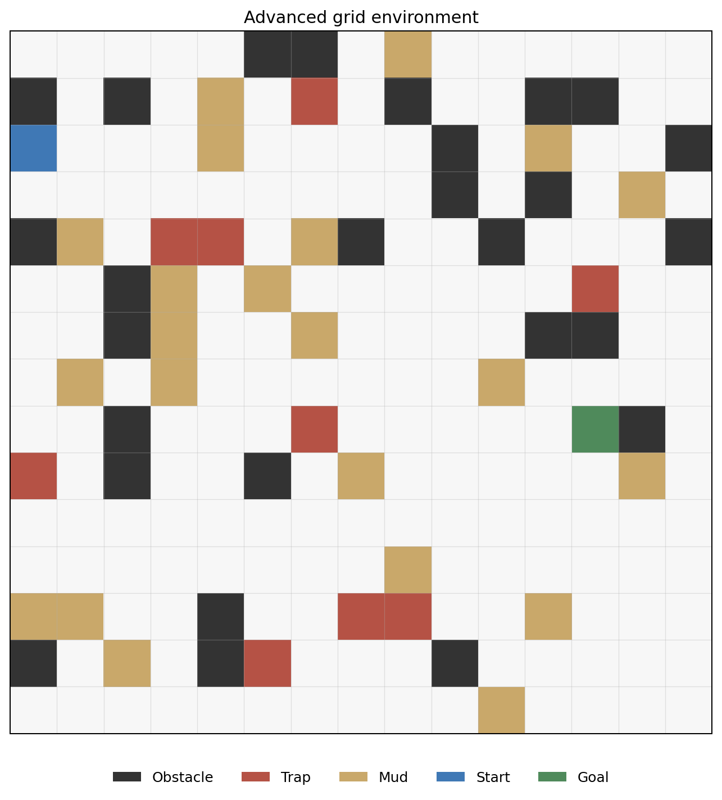
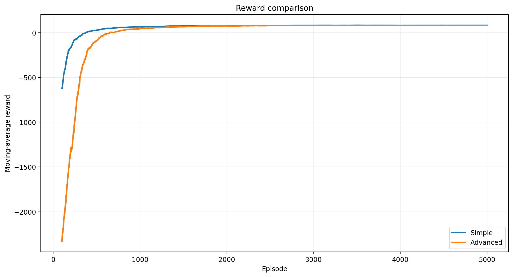

# Reinforcement Learning Exploration Agent

A grid-world reinforcement learning project built from scratch to study how a tabular agent learns when navigation becomes progressively more costly.

The task stays the same throughout the experiments: reach a fixed goal on a 15 × 15 map. The simple environment contains obstacles only, while the advanced version adds mud cells and traps. Both environments use the same seed and base obstacle layout, which makes the comparison easier to interpret.



## Environment

The agent can move up, down, left or right. An episode ends when the goal is reached or after 900 steps.

| Event | Reward |
| --- | ---: |
| Regular move | -1 |
| Mud cell | -4 |
| Collision | -6 |
| Trap | -25 |
| Goal | +100 |

A trap sends the agent back to its starting position. Mud remains traversable, but makes a route more expensive.

The advanced map uses:

```text
obstacle density = 0.12
trap density     = 0.04
mud density      = 0.10
```

## Q-learning

The state is the agent's position in the grid. The Q-table stores one value for each state-action pair.

Actions are selected with an epsilon-greedy policy, with random tie-breaking when several actions share the highest Q-value.

After each transition, the table is updated with:

$$
Q(s,a) \leftarrow Q(s,a) + \alpha \left[r + \gamma \max_{a'}Q(s',a') - Q(s,a)\right]
$$

For terminal transitions, only the immediate reward is used.

The default training configuration is:

```text
episodes = 5000
alpha    = 0.10
gamma    = 0.95
epsilon  = 1.00
seed     = 4
```

Epsilon decreases during training. The curves below use a 100-episode moving average.

## Results

### Simple and advanced environments

The advanced environment is much less forgiving at the beginning of training. Random exploration leads to more collisions, longer episodes and repeated returns to the starting position after traps.



| Metric | Simple | Advanced |
| --- | ---: | ---: |
| Mean reward, first 100 episodes | -620.0 | -2328.7 |
| Mean steps, first 100 episodes | 394.1 | 788.5 |
| Mean reward, last 100 episodes | 81.7 | 80.3 |
| Greedy evaluation reward | 83 | 83 |
| Greedy evaluation steps | 18 | 18 |

Despite the large gap during exploration, both agents eventually learn a policy that reaches the goal in 18 steps, without a collision or trap during evaluation.

On this map, the hazards mainly affect the learning process rather than the final route.


### Learning rate

The learning rate was tested with values 0.05, 0.10, 0.30 and 0.50 while keeping gamma fixed at 0.95, repeated on 4 fixed maps (mean ± standard deviation across maps).


All four values converge to essentially the same final reward on every map (77 to 79, within about 3 points of each other). Alpha = 0.10 is kept as a neutral baseline rather than presented as an optimal value.

### Discount factor

The discount factor was tested with values 0.80, 0.90, 0.95 and 0.99 while keeping alpha fixed at 0.10, on the same 4 maps.


Same pattern: all four values converge to essentially the same result, so gamma = 0.95 remains the default setting. Repeating the sweep across 4 different maps confirms this insensitivity is not an artifact of a single fixed layout.

## Deep Q-Network

The Q-table above only works because the map stays fixed for all 5000 episodes. It has no way to generalize to a map it has never seen. The DQN agent generates a new map every episode instead, to test whether a learned policy can generalize across layouts rather than to beat the tabular agent on its fixed map.

### State representation

The agent receives a local 5×5 window around its position instead of its exact coordinates, one-hot encoded over 4 channels: out-of-bounds, obstacle, trap, mud. A free cell activates none of them, since it is fully determined by the other four. A compass vector is added on top, the normalized displacement to the goal, so the agent still knows which direction to move once the goal leaves the window.

The last 4 observations are stacked into a single input. Without it the policy has no memory of where it has just been, which turned out to matter (see Problems below).

### Reward shaping

A new map every episode means the agent rarely reaches the goal through exploration alone, and there is no fixed layout to memorize a route through. A potential-based shaping term is added to the reward so that moving toward the goal is rewarded at every step:

$$
\Phi(s) = -\,d_{\text{Manhattan}}(\text{agent}, \text{goal}), \qquad
F(s,a,s') = \gamma\,\Phi(s') - \Phi(s)
$$

$\Phi$ is forced to 0 on every terminal state (goal reached or timeout), which the policy-invariance proof (Ng, Harada & Russell, 1999) requires.

An earlier version added a second term penalizing revisited positions during training, meant to discourage the cycling described below. Removed after testing: on its own it solved fewer held-out maps than no penalty at all (see Results).

### Training pool

Generating a brand new map every episode meant no map was ever seen twice, and the only trace of anything the agent learned on one lived in the replay buffer until it got evicted. Training now draws each episode's map, with replacement, from a pool of 50 maps generated once at the start of the run. The evaluation maps are generated separately and never enter the pool.

### Anti-cycle guardrail

A greedy policy with no memory of past states is a deterministic function of the map and position: if it ever returns to a state without reaching the goal, it repeats the same action forever (see Problems). Evaluation now tracks the last `2 * size` positions visited. As long as the agent keeps reaching new positions it takes its best action as usual; once it revisits one, it takes the next-best action instead, then the one after that, and falls back to a random action if it has tried every action this way and still not escaped. This only changes how the trained network is used at evaluation time, not how it is trained.

### Training configuration

```text
episodes           = 2000
gamma              = 0.99
learning rate      = 1e-4 (Adam)
batch size         = 64
epsilon            = 1.00 -> 0.05 (x0.999 per episode, floor not reached within 2000 episodes)
replay capacity    = 50000
target update freq = 1000 steps
frame stack size   = 4
training pool      = 50 fixed maps, sampled with replacement
```

The target is computed with Double DQN: the online network picks the action, the target network values it, which limits the overestimation bias of a plain `max`.

### Evaluation

The training reward includes the shaping term and a map drawn from the training pool, so it says little about how good the policy actually is. Every 100 episodes, the greedy policy plus the anti-cycle guardrail is evaluated instead on 15 fixed seeds, never used for training, with the raw environment reward. The evaluation maps are generated without disturbing the training run's random state.

### Results

The single-frame agent's evaluation got stuck at 900/900, a full timeout on every held-out map, in 23 of its 25 checkpoints. Adding the 4-frame stack raised its best checkpoint to 4 out of 5 fixed maps solved, in 22-32 steps, though which map failed changed from run to run.

With the training pool and 15 evaluation maps instead of 5, before the guardrail existed, the best checkpoint solved 10 of the 15. Adding the guardrail to that same checkpoint raised it to 14 of 15.

Once the guardrail existed, it became possible to check whether the revisit penalty was still worth its complexity. Four 2000-episode runs, all evaluated with the guardrail:

| Frame stack | Revisit penalty | Solved | Mean reward / steps |
| --- | --- | ---: | ---: |
| yes | yes | 14 / 15 | -145.9 / 132.5 |
| yes | no | 15 / 15 | -127.7 / 129.2 |
| no | yes | 11 / 15 | -690.7 / 392.6 |
| no | no | 12 / 15 | -554.0 / 346.9 |

The frame stack accounts for essentially all of the improvement. The revisit penalty on its own scores worse than no penalty at all. It was removed.

### Problems

The training reward looked like it was improving steadily, but that was mostly an artifact: the shaping term rewards getting closer to the goal even when the goal is never reached, and each episode's map has its own difficulty. Fixed-seed evaluation showed the agent was actually failing on held-out maps for most of training.

Traced on a held-out map, both an untrained network and a fully trained one, from before the frame stack existed, oscillated between two adjacent cells for the full 900 steps: a greedy, memoryless policy that revisits a state without reaching the goal repeats the same action forever. The frame stack reduced this a lot on its own. The revisit penalty was added to try to reduce it further, and the anti-cycle guardrail was added to eliminate it outright at evaluation time.

Once the guardrail could rescue a stuck run regardless of what training produced, it became possible to isolate the frame stack and the revisit penalty instead of only testing them together. The revisit penalty turned out to be actively harmful on its own, not just unnecessary (see Results) - its reward depends on recent position history rather than only the current state, so it never had the policy-invariance guarantee the rest of the shaping has, and in practice it made the training reward noisier without a payoff.

Checked whether the maps that failed were simply harder: for every evaluation map, the real shortest path (BFS, accounting for walls) is exactly the Manhattan distance, so none of them ever required moving away from the goal to reach it. The specific map that failed also changed from run to run on the same fixed evaluation set. Both pointed to training variance rather than map difficulty as the driver of the failures the guardrail now catches.

## Repository structure

```text
agents/        Q-learning and DQN agents, action-selection logic
environment/   Base grid world and advanced environment
experiments/   Training and evaluation scripts, split into q_learning/ and dqn/, plus the cross-agent comparison
utils/         Generic helpers (frame stacking)
results/       Configurations, metrics, Q-tables, DQN checkpoints and figures, split into q_learning/ and dqn/
```

## Running the experiments

Install the dependencies from the repository root:

```bash
pip install -r requirements.txt
```

Train the simple and advanced agents:

```bash
python -m experiments.q_learning.q_learning_training
```

Generate the environment comparison figures:

```bash
python -m experiments.q_learning.compare_experiments
```

Run the hyperparameter sweep (alpha and gamma, repeated across 4 fixed maps):

```bash
python -m experiments.q_learning.hyperparameter_experiments
```

Each run saves its configuration, episode metrics, final evaluation, grid and Q-table. The comparison plots are generated from the saved results, so training does not need to be repeated to rebuild the figures.

Train the DQN agent (saves a checkpoint every 100 episodes to `results/dqn/dqn_checkpoints/`):

```bash
python -m experiments.dqn.DQN_training
```

## Next steps

- test PPO under the same evaluation protocol.
