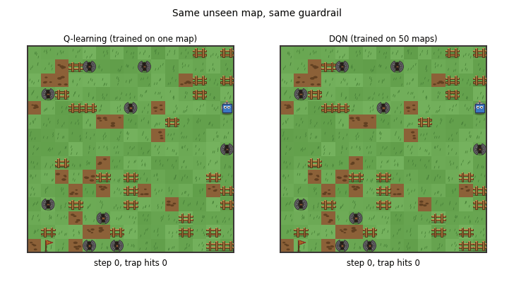
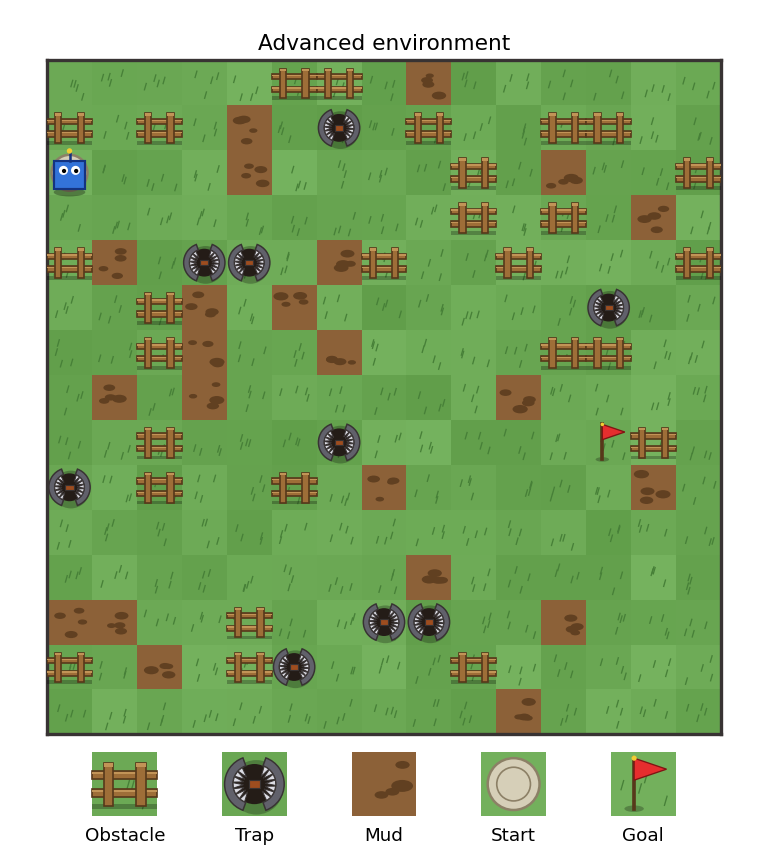
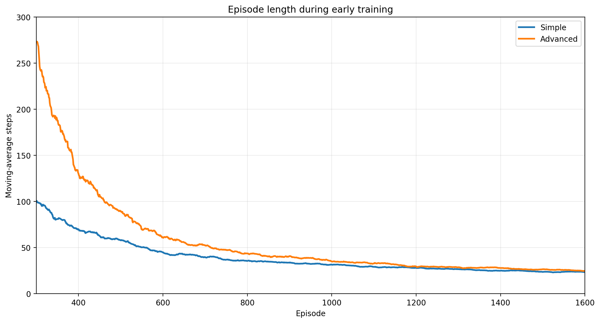
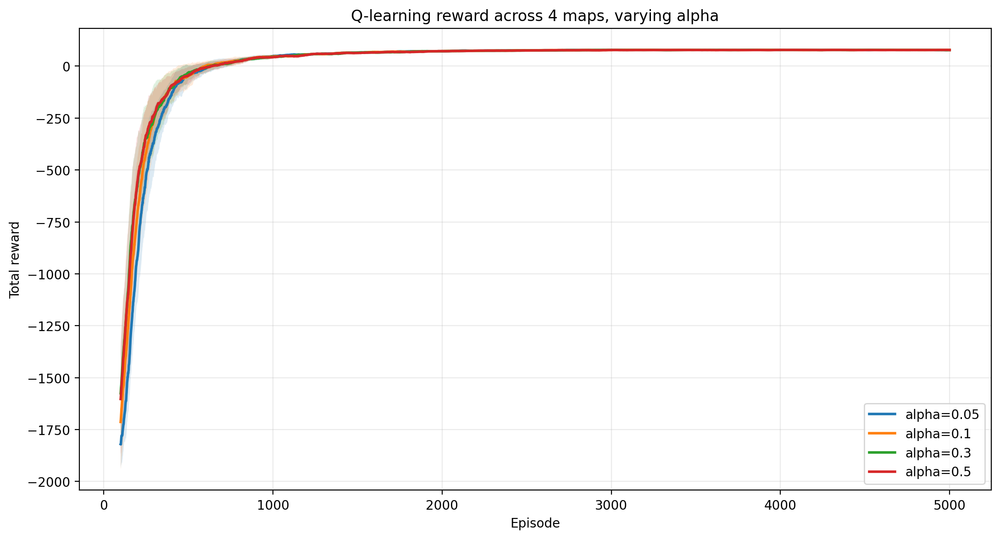
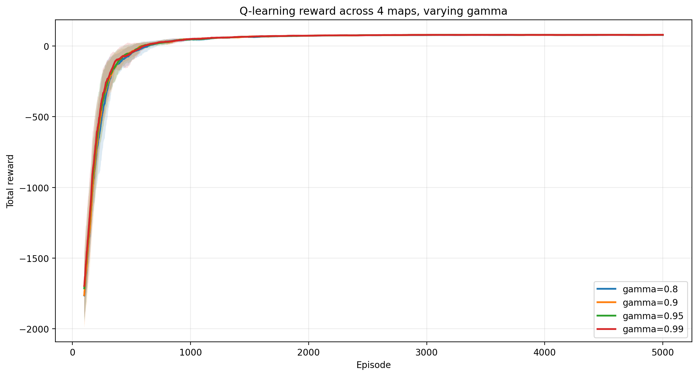
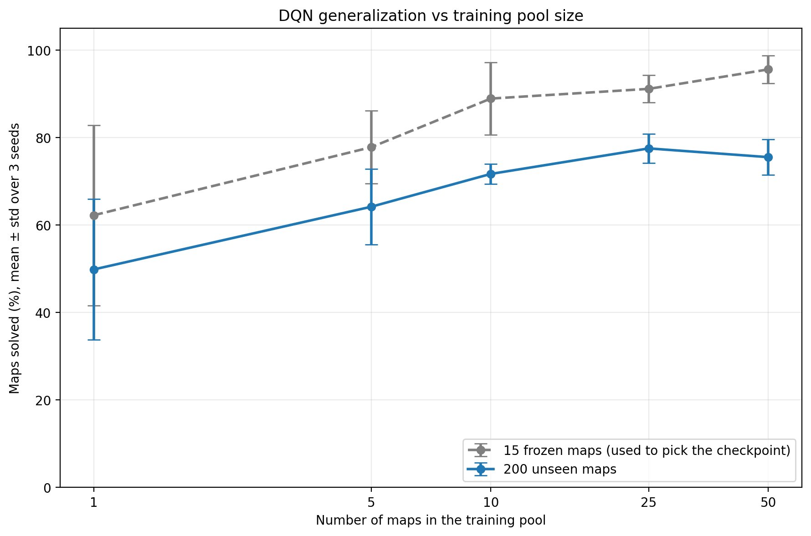
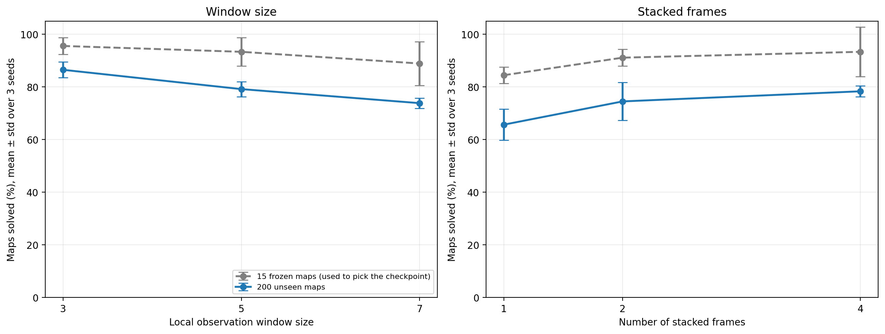
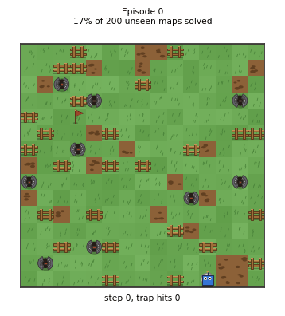
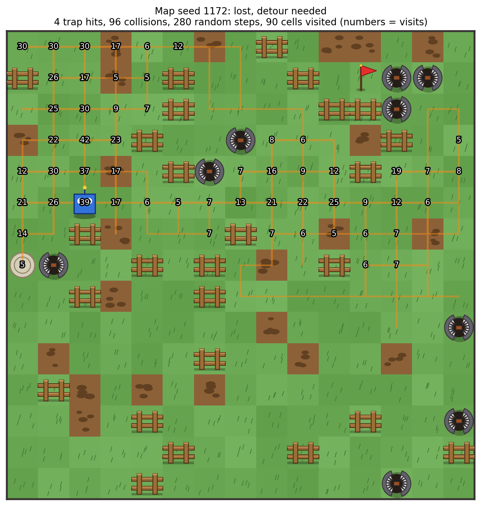

# Reinforcement Learning Exploration Agent

A grid-world project built from scratch. A Q-learning agent first learns a single map. A DQN agent is then trained to solve maps it has never seen.



Same unseen map, same rules. The Q-learning agent was trained on one map and runs out of steps. The DQN was trained on 50 maps and reaches the flag in 34 steps.

On 200 maps that were never used for training or for choosing a model, Q-learning solves 6% and the DQN solves about 78% on average.

## Environment

The agent can move up, down, left or right on a 15 × 15 grid. An episode ends when the goal is reached or after 900 steps.

| Event | Reward |
| --- | ---: |
| Regular move | -1 |
| Mud cell | -4 |
| Collision | -6 |
| Trap | -25 |
| Goal | +100 |

Obstacles are drawn as fences and traps as bear traps. A trap sends the agent back to its starting position. Mud can be crossed but makes a route more expensive. Hitting a fence or the border counts as a collision.

The advanced map uses:

```text
obstacle density = 0.12
trap density     = 0.04
mud density      = 0.10
```



## Q-learning

The state is the agent's position in the grid. The Q-table stores one value for each state-action pair.

Actions are selected with an epsilon-greedy policy, with random tie-breaking when several actions share the highest Q-value.

After each transition, the table is updated with:

$$
Q(s,a) \leftarrow Q(s,a) + \alpha \left[r + \gamma \max_{a'}Q(s',a') - Q(s,a)\right]
$$

For terminal transitions, only the immediate reward is used.

The default training configuration is:

```text
episodes = 5000
alpha    = 0.10
gamma    = 0.95
epsilon  = 1.00
seed     = 4
```

Epsilon decreases during training. The curves below use a 100-episode moving average.

### Simple and advanced environments

The simple environment has the same layout without mud and traps. The advanced one is much less forgiving at the beginning of training. Random exploration leads to more collisions, longer episodes and repeated returns to the start after traps.


| Metric | Simple | Advanced |
| --- | ---: | ---: |
| Mean reward, first 100 episodes | -620.0 | -2328.7 |
| Mean steps, first 100 episodes | 394.1 | 788.5 |
| Mean reward, last 100 episodes | 81.7 | 80.3 |
| Greedy evaluation reward | 83 | 83 |
| Greedy evaluation steps | 18 | 18 |

Despite the large gap during exploration, both agents end up with a policy that reaches the goal in 18 steps, without a collision or a trap. On this map the hazards only slow down the learning, they do not change the final route.



### Learning rate and discount factor

The learning rate was tested at 0.05, 0.10, 0.30 and 0.50 with gamma fixed at 0.95. The discount factor was tested at 0.80, 0.90, 0.95 and 0.99 with alpha fixed at 0.10. Each sweep was repeated on 4 different maps, and the curves show the mean and the standard deviation across maps.





On every map, all the values end at almost the same reward (77 to 79). Alpha = 0.10 and gamma = 0.95 stay as default values, but they are not better than the others. The 4 maps show that this low sensitivity does not come from one particular layout.

## Deep Q-Network

The Q-table only works because the map never changes during the 5000 episodes. On another map it has nothing to rely on (see the results below). The DQN is trained on many maps instead, to see whether a policy can learn something that works on any layout.

### Observation

The agent does not know its coordinates. It sees a 5×5 window around itself, one-hot encoded over 4 channels: out of the grid, obstacle, trap and mud. A free cell activates none of them. A compass vector is added, the normalized displacement to the goal, so that the agent still knows where to go when the goal is outside the window.

The last 4 observations are stacked into one input. Without them the policy cannot know where it has just been.

### Reward shaping

On a new map, the agent rarely reaches the goal by exploring. A shaping term is added to the reward so that getting closer to the goal is rewarded at every step:

$$
\Phi(s) = -\,d_{\text{Manhattan}}(\text{agent}, \text{goal}), \qquad
F(s,a,s') = \gamma\,\Phi(s') - \Phi(s)
$$

$\Phi$ is set to 0 on every terminal state (goal reached or timeout). This is what the policy-invariance result of Ng, Harada and Russell (1999) requires, and it guarantees that the shaping does not change which policy is optimal.

### Training pool

Each episode is played on a map drawn at random from a pool of 50 maps, generated once at the start of the run. The evaluation maps are generated separately and never enter the pool.

### Anti-cycle guardrail

A greedy policy has no memory. If it comes back to a position without having reached the goal, it plays the same move again and loops until the step limit. To avoid this, the evaluation keeps the last `2 * size` positions. While the agent reaches new positions, it plays its best move. When it comes back to a recent position, it plays its second best move, then the third and so on, and falls back to a random move once all of them have been tried. The guardrail is only used for evaluation, not for training.

### Training configuration

```text
episodes           = 2000
gamma              = 0.99
learning rate      = 1e-4 (Adam)
batch size         = 64
epsilon            = 1.00 -> 0.05 (x0.999 per episode, floor not reached within 2000 episodes)
replay capacity    = 50000
target update freq = 1000 steps
frame stack size   = 4
observation window = 5 x 5
training pool      = 50 fixed maps, sampled with replacement
```

The target is computed with Double DQN: the online network picks the action and the target network gives its value, which limits the overestimation of a plain `max`.

### Evaluation

Two sets of maps are used. The 15 frozen maps (seeds 101 to 115) are played every 100 episodes during training, and the checkpoint with the best score on them is kept. Since it is chosen on these maps, its score there is a bit too good. The 200 unseen maps (seeds 1001 to 1200) are used for nothing else, so their score is the one to trust.

A map is solved when the goal is reached within 900 steps. Every evaluation uses the greedy policy, the guardrail and the real reward, without shaping.

## Results

### Q-learning against DQN

The Q-table trained on the fixed map is played on the same maps as the DQN, with the same guardrail.

| | Q-learning | DQN |
| --- | ---: | ---: |
| Solved, 15 frozen maps | 1 / 15 | 15 / 15 |
| Mean reward, 15 frozen maps | -2224.3 | -127.7 |
| Mean steps, 15 frozen maps | 856.1 | 129.2 |
| Solved, 200 unseen maps | 12 / 200 (6.0%) | 176 / 200 (88.0%) |
| Mean reward, 200 unseen maps | -2374.4 | -407.2 |
| Mean steps, 200 unseen maps | 868.6 | 244.1 |

The DQN in this table is the run kept in `results/dqn/dqn_checkpoints/`. The same configuration was trained 9 times in the experiments below, and none of those runs does as well on the unseen maps. They solve 77.7% ± 3.5 of them (from 71.5% to 82.5%), with a mean reward of -627 ± 85. The figure to remember for the DQN is therefore about 78%, and the 88% is a good run.

Q-learning does not fail because it meets positions it has never seen. Only 13.9% of its steps on the frozen maps (14.1% on the unseen ones) are on a position missing from the Q-table. The values it stores are the ones of the map it was trained on, and on another map they do not lead to the goal. It reaches the 900-step limit on 94% of the unseen maps.

### Training pool size

The DQN was trained on pools of 1, 5, 10, 25 and 50 maps, with 3 seeds each and the rest of the configuration unchanged. Mean ± standard deviation over the 3 seeds:

| Pool size | Unseen maps solved |
| --- | ---: |
| 1 | 49.8% ± 16.0 |
| 5 | 64.2% ± 8.6 |
| 10 | 71.7% ± 2.3 |
| 25 | 77.5% ± 3.3 |
| 50 | 75.5% ± 4.0 |



With a single training map, the DQN already solves about half of the unseen maps, far above Q-learning. This is because it sees a small window around itself and the direction of the goal, and not its position. Each map added to the pool helps up to about 25. Between 25 and 50 the difference is smaller than the spread between seeds, and the spread itself goes from 16 points with one map to 2 to 4 points from 10 maps on.

The grey curve is the score on the 15 frozen maps. It keeps rising up to 50 maps, while the blue one flattens. The 12 to 20 points between the two come from choosing the checkpoint on the frozen maps.

### Ablations

Each setting was trained 3 times (seeds 4, 104 and 204). The rest of the configuration is the reference one: 50 maps, 4 frames and a 5×5 window.



#### Observation window

| Window | Unseen maps solved |
| --- | ---: |
| 3×3 | 86.5% ± 2.9 |
| 5×5 | 79.2% ± 2.9 |
| 7×7 | 73.8% ± 1.9 |

A smaller window is better. The 3×3 window beats the 5×5 one by 7 points and the 7×7 one by 13, more than the spread between seeds (2 to 3 points). The 5×5 window was picked at the start of the project and never tuned. The compass may already give most of what the agent needs, and a larger window adds inputs the network has to learn to ignore. This was only tested with 4 frames and a pool of 50 maps.

#### Stacked frames

| Frames | Unseen maps solved |
| --- | ---: |
| 1 | 65.7% ± 5.9 |
| 2 | 74.5% ± 7.3 |
| 4 | 78.3% ± 2.1 |

More frames help, by 12.6 points from 1 to 4. From 2 to 4 the gain is 3.8 points, which is within the spread between seeds. A single frame still solves about two thirds of the unseen maps, so the stack helps but is not what makes the agent generalize. 8 frames were not tested.

#### Frame stack and revisit penalty

An earlier version of the training added a penalty for revisiting a position, to fight the loops described in the problems below. Once the guardrail existed, it was possible to test it alone. These four runs were made on the 15 frozen maps, all evaluated with the guardrail:

| Frame stack | Revisit penalty | Solved | Mean reward / steps |
| --- | --- | ---: | ---: |
| yes | yes | 14 / 15 | -145.9 / 132.5 |
| yes | no | 15 / 15 | -127.7 / 129.2 |
| no | yes | 11 / 15 | -690.7 / 392.6 |
| no | no | 12 / 15 | -554.0 / 346.9 |

The frame stack brings almost all of the improvement. The penalty alone does worse than no penalty at all, so it was removed.

### Training progress

The training reward goes up steadily, but it includes the shaping and it is measured on the training maps, so it says little about the real quality of the policy. The evaluation reward tells another story.


The training reward climbs to about 0. The evaluation reward stays between -900 and -130 from episode 100 on and moves a lot from one checkpoint to the next. The best evaluation is around episode 1700, not at the end, which is why the best checkpoint is kept and not the last one.



The animation replays one unseen map with the checkpoints of a run. The map was picked because every checkpoint from episode 100 solves it, so that the routes can be compared. The percentage above the map is the share of the 200 unseen maps each checkpoint solves: 17% at episode 0, 77.5% at episode 100, 77% at episode 500, 80% at episode 1000 and 88% for the best checkpoint. Most of the progress happens in the first 100 episodes. After that the route gets shorter on this map (400, 130, 110 and 108 steps), but the number of maps solved changes little.

### Failure analysis

The kept checkpoint fails on 24 of the 200 unseen maps, all of them by reaching the 900-step limit. Compared with the 176 maps it solves, the failed maps involve far more guardrail steps (280 against 45 on average), collisions (94 against 15) and trap hits (17 against 2).

The failures fall into three groups, sorted with two thresholds (15 trap hits, 150 random steps):

| Group | Maps | What happens |
| --- | ---: | --- |
| Trap loop | 6 | The agent follows the same route again and again and enters a trap, most of the time at the same place. |
| Lost, detour needed | 9 | The shortest path first moves away from the goal. On map 1172 the agent wanders over a large part of the grid without finding the way. |
| Lost, no detour needed | 9 | The shortest path is as short as the Manhattan distance, yet the agent does not find it and takes many random steps. On map 1095 it stays around its start. |

Maps that need a detour fail more often: 11 of 41 (27%) against 13 of 159 (8%) for the others. Most failures still happen on maps without a detour, so the layout is only part of the explanation.

In the figures below, the orange line is the path of the agent, a number on a cell is how many times the agent went through it (shown from 5 visits) and the robot stands where the run ended.





The network itself never chooses to enter a trap. Among the 400 trap entries on the failed maps, none comes from its best or second best action. 282 come from its fourth choice, 19 from its third and 99 from the random fallback. On map 1122 the network gives the trap move a value of -92, against about -67 for the three other moves. The guardrail goes through the moves from best to worst while the agent keeps coming back to the same positions. An agent that is stuck next to a trap ends up being sent into it, and the trap sends it back to the start, where the same route begins again.

The guardrail only remembers the last 30 positions, which could explain the loops. A memory of 60, 100 or 200 positions did not help: the agent solves fewer unseen maps (171, 170 and 164 instead of 176) and only one of the six trap loops is fixed, with the longest memory.

## Problems and fixes

The training reward looked like it was improving, but it was misleading. The shaping rewards getting closer to the goal even when the goal is never reached, and every map has its own difficulty. Playing fixed maps showed that the agent was failing on most held-out maps. The evaluation on fixed maps, with the real reward, became the reference.

The agent often looped between two cells until the step limit. A greedy policy without memory plays the same move forever when it comes back to a position. This was seen on a held-out map with an untrained network and with a trained one. Stacking the last 4 observations reduced it a lot: the one-frame agent timed out on every held-out map in 23 of its 25 checkpoints. The guardrail then removed the loops that were left. On the same checkpoint, it raised the number of solved maps from 10 to 14 out of 15.

A penalty for revisiting a position was added to the training to reduce the loops. Once the guardrail made it possible to test it alone, it turned out to be harmful (see the ablations). Its reward depends on the recent history and not only on the current position, so it does not have the policy-invariance guarantee of the rest of the shaping. It was removed.

The last checkpoint is rarely the best one, so the checkpoint with the best evaluation is kept. Choosing it on the 15 frozen maps made the scores on these maps too good. The kept checkpoint solves 15 of 15 of them but 88% of the unseen maps, and the same configuration trained again solves about 78%. This is why every result above is also measured on 200 maps that are used for nothing else.

The seed fixes the maps but not the initialization of the network, because no PyTorch seed is set. Two runs with the same seed give different results: the nine runs of the reference configuration go from 71.5% to 82.5% of the unseen maps. All the comparisons use 3 seeds and show the mean and the standard deviation. Setting the PyTorch seed would make a single run reproducible.

The first count of unseen states in the Q-learning evaluation gave 0.2%, which was wrong. The evaluation added the unknown states to the Q-table as it went, so each of them was only counted on its first visit. Counting every step against the states known beforehand gives 13.9%.

<details>
<summary>Other problems</summary>

With a new map for every episode, no map ever came back and the training was unstable. The maps are now drawn from a pool of 50.

The shaping potential was first set to 0 when the goal was reached, but not on a timeout. The policy-invariance result needs it on every terminal state, so it is now set to 0 in both cases.

A shaping potential based on the real shortest path (BFS) would have helped the agent out of dead ends. It was rejected because it gives the agent the layout of the whole map, which the experiment is meant to avoid. The compass only gives the direction and the distance to the goal. A check on the 15 frozen maps also showed that the shortest path is always the Manhattan distance there, so the failures were not caused by detours. The 200 unseen maps show that detours make failures more likely, without being the main cause.

The training was slower than expected. A profile showed the Adam update running in its slow single-tensor mode, fixed with `foreach=True`, and the replay buffer was built on a `deque`, which is slow for random access. It is now a list with a circular index.

The map generation changed when the environment was adapted for the DQN. Running the Q-learning training again now gives another map than the one shown in this README. The saved Q-table and grid are the ones behind every Q-learning result here.

</details>

## Conclusion

A Q-learning agent trained on one map solves 6% of 200 unseen maps. A DQN that sees a small window around itself and the direction of the goal solves about 78% of them on average over nine runs, and 88% for the best one. On the 15 frozen maps the numbers are 1 out of 15 for Q-learning and 15 out of 15 for the kept DQN. Q-learning does know most of the positions. What it stores is only true for its own map. The DQN learns a rule based on what is around it, and the rule works on other maps.

How well it generalizes depends on the training. One training map gives 49.8% of the unseen maps, 25 maps give 77.5% and more maps did not help. A 3×3 window (86.5%) does better than the 5×5 window of the main runs (79.2%) and the 7×7 one (73.8%). More stacked frames help, from 65.7% with one frame to 78.3% with four.

Scores measured on the maps used to choose the checkpoint are 12 to 20 points too high. The remaining failures are timeouts. The agent either loops into the same trap, or has to move away from the goal before reaching it, or never finds its way and ends up taking random steps. The guardrail is what lets a looping policy reach the goal, and it is also what sends stuck agents into traps, which the network never picks by itself.

All the results are for 15 × 15 maps with a single set of densities.

## Next steps

- make the guardrail skip the moves that lead into a visible trap, then run the experiments again
- set the PyTorch seed so that a single run can be reproduced
- test the 3×3 window together with the other settings
- test PPO under the same evaluation protocol

## Repository structure

```text
agents/        Q-learning and DQN agents, action-selection logic
environment/   Base grid world and advanced environment
experiments/   Training and evaluation scripts, split into q_learning/ and dqn/, plus the cross-agent comparison
utils/         Generic helpers (frame stacking, map drawing)
results/       Configurations, metrics, Q-tables, DQN checkpoints, figures and animations
```

<details>
<summary>Running the experiments</summary>

Install the dependencies from the repository root:

```bash
pip install -r requirements.txt
```

Train the simple and advanced Q-learning agents:

```bash
python -m experiments.q_learning.q_learning_training
```

Generate the environment comparison figures:

```bash
python -m experiments.q_learning.compare_experiments
```

Run the alpha and gamma sweeps, repeated across 4 maps:

```bash
python -m experiments.q_learning.hyperparameter_experiments
```

Each run saves its configuration, episode metrics, final evaluation, grid and Q-table. The comparison plots are built from the saved results, so the training does not need to be repeated to rebuild the figures.

Train the DQN (a checkpoint is saved every 100 episodes in `results/dqn/dqn_checkpoints/`):

```bash
python -m experiments.dqn.DQN_training
```

Compare the Q-table and the DQN checkpoint on the frozen maps:

```bash
python -m experiments.generalization_comparison
```

The three DQN experiments train 9 to 15 networks of 2000 episodes each and take several hours. The results are saved after every run, and running a script again resumes where it stopped:

```bash
python -m experiments.dqn.pool_size_experiment
python -m experiments.dqn.window_size_experiment
python -m experiments.dqn.stack_size_experiment
```

Evaluate every checkpoint of these experiments on the 200 unseen maps, and analyze the failures of the kept checkpoint:

```bash
python -m experiments.dqn.unbiased_evaluation
python -m experiments.dqn.failure_analysis
```

Rebuild the images and animations of this README:

```bash
python -m experiments.make_animations
```

The checkpoints are not stored in the repository, so the scripts that load them need the trainings above to have been run first.

</details>
